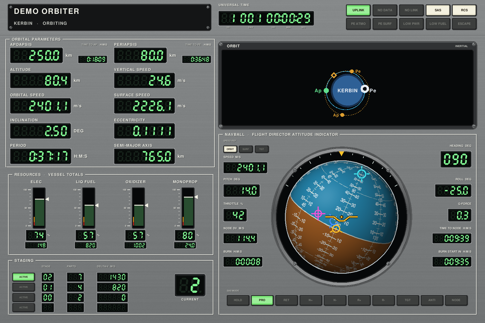
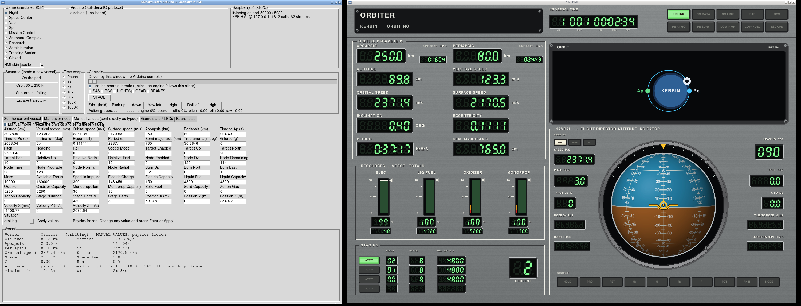
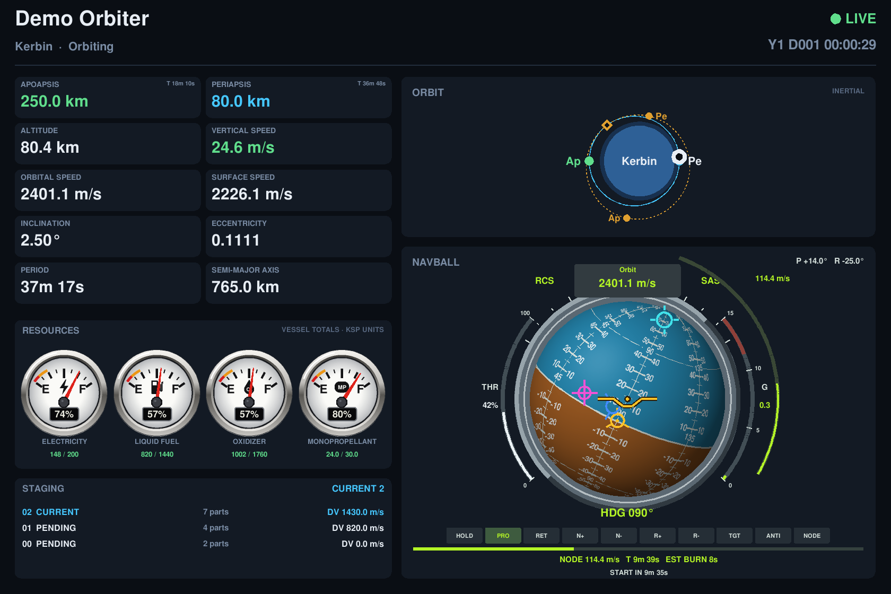

# KSPKontroller

**Build a physical flight deck for Kerbal Space Program.**

A hardware control panel, a dedicated Raspberry Pi flight display, and a simulator that lets you
explore both before connecting hardware or launching the game. Built with Arduino, C# and C++17.
MIT licensed and ready to adapt to your own cockpit.



*Apollo skin rendered by the C++ HMI using its built-in demo orbit. All screenshots on this page
come directly from the applications and show simulated telemetry. Click an image to inspect it.*

## What you can build

- **A panel you can operate by touch.** SAS and RCS buttons, game-confirmed status LEDs, and a
  12x8 matrix showing fuel, staging, attitude and flight data on an Arduino UNO R4 WiFi.
- **A dedicated flight display.** Track apoapsis, periapsis, altitude, speeds and orbital elements;
  follow the NavBall, live vessel position and planned maneuver orbit; monitor resources and staging.
- **Your preferred instrument style.** Choose the Apollo panel with segment readouts and illuminated
  indicators, or the Classic dark interface with analog resource gauges. Both use the same telemetry.
- **An interactive test bench.** Load a pad, orbit, suborbital or escape scenario. Change values,
  attitude, resources, scene and skin from the test app while the actual HMI responds.
- **A project you can extend.** Source code, documented communication contracts, PlantUML diagrams,
  automated checks and hardware-free development paths are included.

The display and physical panel can be used independently. Start with the display, build a few buttons,
or work entirely in the simulator while planning your hardware.

## Try it without a Pi or KSP

You need **Git, a running Docker engine with Linux containers, and Bash**. On macOS/Linux use your
terminal; on Windows use Git Bash with Docker Desktop. The Docker desktop has been validated on
Apple Silicon; Windows Docker validation is still open.

```bash
git clone https://github.com/AlaNLrdE/KSPKontroller.git
cd KSPKontroller
./ci hmi_desktop
```

Open **<http://localhost:6080/vnc.html?autoconnect=true&resize=scale>** after the initial build.
The first run downloads dependencies and compiles the HMI; later runs reuse the build environment.



*The actual Tk simulator and C++ HMI running together in the Docker desktop. The simulator is in
manual mode, with the Arduino disabled; telemetry travels over kRPC and scene/skin context over UDP.*

Try these first:

1. Choose **Orbit 80 x 250 km** or **On the pad** and watch the display change.
2. Open **Manual values**, enable **Manual mode**, edit a value and press **Apply values**.
3. Change **HMI skin** between `apollo` and `classic`.
4. Select a Space Center facility to see its preparation screen, then return to **Flight**.

Default container architecture is `linux/arm64`. On an Intel/AMD host, use
`HMI_PLATFORM=linux/amd64 ./ci hmi_desktop` for native x86 execution. A different architecture may
require Docker's CPU emulation. Both apps run inside the container; you only need a browser to use them.

To stop the desktop:

```bash
docker stop ksphmi-desktop
```

If the Docker CLI is not on your terminal's PATH, stop `ksphmi-desktop` in Docker Desktop. Repeating
`./ci hmi_desktop` keeps an existing session. To rebuild edited code, stop it and run the command again.
Stop the desktop before running automated tests that share its architecture's build directory.

## Two looks, one flight-data model



*Classic skin, captured from the same C++ application using the built-in demo orbit.*

The HMI includes flight, connection/waiting and facility views. Its flight-control information and
staging queue are **read-only**. The physical Arduino controls are the path that changes game state.

## How it fits together

| Component | Runs on | What it does |
| --- | --- | --- |
| [Panel firmware](arduino-sketch/KSPIODemo9/) | Arduino UNO R4 WiFi | Samples buttons, sends controls, drives LEDs and the matrix. |
| [KSPSerialIO mod](KSPSerialIO/) | KSP / Unity-Mono, C# .NET 3.5 | Sends serial telemetry, applies panel input and serves scene context. |
| [Flight display](hmi-cpp/) | Raspberry Pi, C++17 / SDL2 | Reads kRPC and renders the instruments. Also runs on a development PC. |
| [Test app](tools/kspsim/) | Development PC or Docker, Python / Tk | Simulates the vessel and serves the same serial, kRPC and context interfaces. |

The panel uses **USB serial at 115200 baud**. The HMI gets vessel data from the separate **kRPC mod**
over TCP and facility context from KSPSerialIO over UDP. It does not need an Arduino connected to
show flight data. [Explore the architecture](docs/architecture.rst) and
[communication contracts](docs/communication.rst) before extending those interfaces.

## Bring it to your hardware

The documented game setup uses **KSP 1.12.5**, **kRPC 0.7.0**, an **Arduino UNO R4 WiFi**, and a
**Raspberry Pi 4 running Raspberry Pi OS Lite Bookworm (64-bit)** with a monitor and a LAN connection.
For HMI development, CMake, a C++17 compiler, SDL2, SDL2_ttf and fonts are required; Docker packages
these dependencies for you. Native macOS and Linux/WSL builds are also available.

| Your next step | Guide |
| --- | --- |
| Wire the panel and understand enabled controls | [Pin map](docs/overview.rst) and [firmware reference](docs/firmware.rst) |
| Build and install the game mod | [Build/deployment](docs/building.rst) and [plugin configuration](docs/plugin.rst) |
| Connect the Pi, configure kRPC and set up kiosk boot | [Raspberry Pi HMI setup](docs/hmi.rst) |
| Add a control, instrument or telemetry value | [Arduino](docs/development/arduino.rst), [mod](docs/development/plugin.rst) and [HMI](docs/development/raspberry-pi.rst) development guides |

The current panel enables SAS, RCS and the matrix screen button. Stage, custom-group input and analog
throttle are disabled until configured and wired. Other protocol axes are extension points, not a
promise that every input is already fitted to this panel. Simulation covers logic and communication;
USB behavior, physical display output and target performance still need the real hardware.

## Develop and contribute

Build an instrument, adapt the panel to your layout, add simulator scenarios, improve the docs, or
help validate another host platform. [Open an issue](https://github.com/AlaNLrdE/KSPKontroller/issues)
with your hardware/OS, steps to reproduce, relevant logs and screenshots, or propose a focused change.

Useful commands from the repository root:

```bash
./ci build_sketch        # Compile firmware; does not flash
./ci build_KSPSerialIO   # Compile the KSP mod
./ci build_hmi           # Compile the native/WSL HMI
./ci hmi --demo          # Run the HMI locally with demo data
./ci test_hmi_container  # Linux build, tests and real client against kspsim
./ci test_hmi_desktop    # Tk controls, C++ skin update, kRPC and browser transport
./ci test_sim           # Simulator and protocol tests
./ci verify             # Repository consistency and available integration evidence
```

Start with the [testing guide](docs/testing.rst) to choose the right validation level. Changes to a
serial packet must update the mod, firmware and simulator together. Read `CLAUDE.md` for repository
coordination rules before deploying to a shared game install or flashing a board.

## Documentation

Browse the [Sphinx site](https://alanlrde.github.io/KSPKontroller/) or the [documentation sources](docs/index.rst).
Architecture, lifecycles, packet layouts, units, recovery and detailed project guides live there.
UML sources are [PlantUML files](docs/diagrams/); the generated site also embeds the Doxygen API reference.

To build locally, install Python 3, Java, Graphviz and Doxygen, then run:

```bash
python3 tools/verify.py --docs-only
./ci diagrams
./ci sphinx
```

Open `build/sphinx/index.html`. See [documentation maintenance](docs/documentation.rst) for dependencies
and [screenshot provenance](docs/images/) for capture settings and regeneration instructions.

## Credits and license

- Original KSPSerialIO by [zitronen](http://forum.kerbalspaceprogram.com/index.php?/topic/60281-hardware-plugin-arduino-based-physical-display-serial-port-io-tutorial-22-april/).
- Fork and macOS port by [hugopeeters](https://github.com/hugopeeters/KSPSerialIO).
- This fork and hardware adaptation by Alan Ocegueda.

[MIT License](LICENSE). Kerbal Space Program is required for live game operation and is not included.
